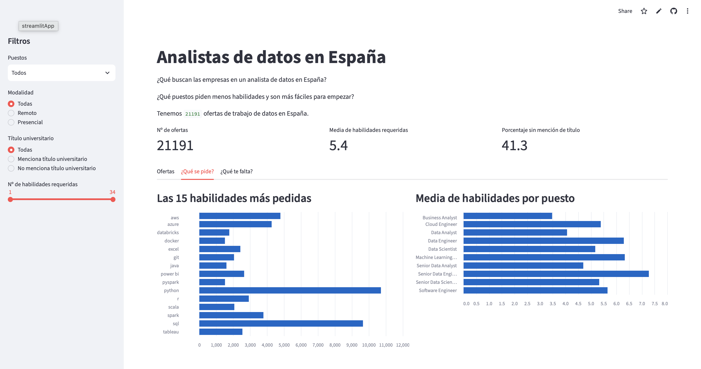

# ¿Qué buscan las empresas en un analista de datos en España?

Un análisis de 21.191 ofertas de trabajo de datos publicadas en España, para quien quiera entrar en el sector y saber qué aprender primero.

## La pregunta

¿Qué habilidades piden las empresas en España a los perfiles de datos, y qué puestos son más accesibles para empezar?

Le interesa a quien quiere entrar en el sector (estudiantes de bootcamps, gente que cambia de profesión) para decidir qué aprender primero, y a los centros de formación para ajustar su temario a lo que pide el mercado.

## Los datos

- ¿De dónde salen los datos?: [data_jobs](https://huggingface.co/datasets/lukebarousse/data_jobs), ofertas de trabajo recogidas de Google por Luke Barousse.

- ¿Cuántos datos hay?: el conjunto completo tiene 785.741 filas y 17 columnas. Me quedo con las ofertas de España y, después de limpiar, quedan 21.191 filas y 11 columnas.

- ¿Qué es cada fila?: una oferta de trabajo de datos publicada en 2023, con el puesto, el título, la ubicación, la empresa, si es en remoto, el tipo de jornada, si menciona título universitario y las habilidades técnicas que pide.

El archivo original pesa 231 MB y no se sube a GitHub. Para reproducir el análisis, hay que descargarlo desde el enlace y guardarlo en `datos/data_jobs.csv`.

## Qué he limpiado y por qué

- Me quedo con las ofertas de España (25.100), que es el mercado que me interesa.

- Quito 7 columnas: el país y la ubicación de búsqueda (siempre es España), los salarios (más del 99 % vacíos), el seguro médico (solo 3 ofertas lo mencionan) y una columna que repetía las habilidades.

- Quito 99 ofertas sin jornada: son el 0,4 % y no cambian los resultados.

- Dejo a propósito los huecos de habilidades (12 %): esas ofertas sirven para el resto del análisis y no quiero inventar el dato.

- Cambio "Spain" por "Sin especificar" (la oferta no dice la ciudad) y "Anywhere" por "Remoto".

- Quito 1 oferta repetida exacta y 3.808 publicadas varias veces (mismo título, empresa, ubicación y habilidades), para no contar sus habilidades varias veces.

- Quito 1 oferta mal recogida, de 35 habilidades, y cambio por "Sin especificar" las empresas que en realidad eran lugares.

- Creo la columna `num_habilidades` (cuántas habilidades pide cada oferta) para tener un número que analizar.

## Lo que he encontrado

1. **Python y SQL son la base:** de las 18.496 ofertas que dicen qué habilidades piden, 10.718 piden Python y 9.658 piden SQL. Ninguna otra habilidad llega ni a la mitad que ellas. Para Data Analyst, la primera es SQL: la pide el 59 % de las ofertas.

2. **Los puestos de analista son la puerta de entrada más accesible:** un Data Analyst pide de media 4,1 habilidades y un Business Analyst 3,5, frente a las 6,3 de un Data Engineer y las 7,3 de un Senior Data Engineer.

3. **El título no es imprescindible, las habilidades sí:** el 41 % de las ofertas (8.761 de 21.191) no menciona que haga falta título universitario, pero piden las mismas habilidades que el resto (5,4 de media).

Son datos de 2023: pueden no reflejar del todo el mercado actual, pero sirven como referencia para buscar trabajo en el sector.

## La app

En la app puedes filtrar las ofertas por puesto, modalidad (remoto o presencial), mención de título universitario y número de habilidades, y ver cómo cambian las métricas y los gráficos de las habilidades más pedidas. En la última pestaña eliges el puesto que quieres y la habilidad que mejor dominas, y la app te dice cuántas ofertas la piden y qué habilidades te faltan.

Enlace: [ofertas-datos-espana.streamlit.app](https://ofertas-datos-espana.streamlit.app)

## Cómo ejecutarlo

1. Crear un entorno e instalar las librerías: `pip install -r requirements.txt`
2. Descargar los datos originales en `datos/data_jobs.csv` (ver el apartado "Los datos").
3. El EDA está en `eda.ipynb`.
4. La app se abre con `streamlit run app.py`.

## Autor

Daniel Ledesma · [GitHub](https://github.com/dledesmalorenzo)
